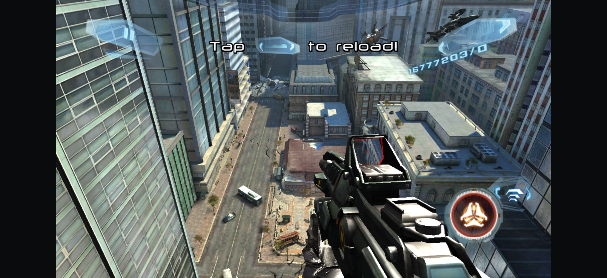
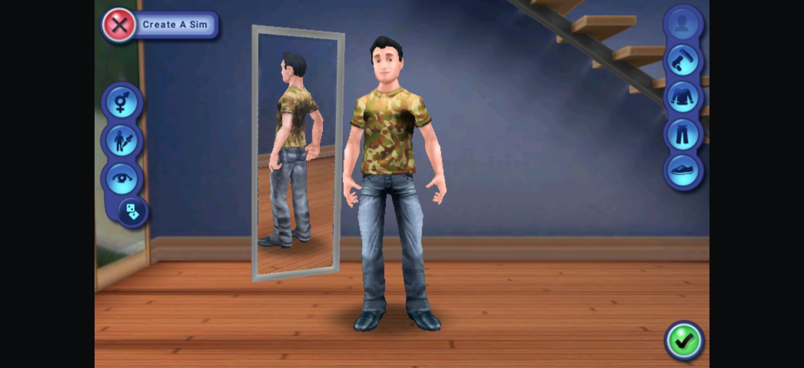
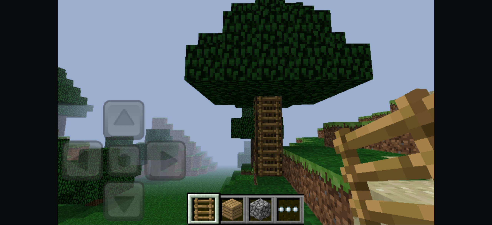

# Armbat

Armbat is a container for 32-bit ARM Android applications running on a 64-bit
device that has no 32-bit ABI. Guest Java code runs on the platform's ART; guest
machine code is translated from A32 to ARM64 by a JIT built on Dynarmic. Root is
not required.

On the surface it is a small library: import an APK, launch it, delete it. The
work sits underneath, in a C++20 runtime with its own ELF loader, syscall layer
and platform stubs.

## How it works

- **One flat 4 GiB arena.** A guest address is a 32-bit offset into it, so
  fastmem works without translating pointers.
- **Real bionic userland.** The guest is not run against a re-implementation of
  libc: `runtime/sysroot` carries the linker, libc, libm, libdl and libstdc++
  from an official `armeabi-v7a` system image, and the container boots them.
- **Syscalls** go through `SVC #0`, Linux ARM EABI, dispatch by `r7`.
- **HLE only where the platform cannot be reused:** JNI, `AAssetManager`, EGL and
  GLES (forwarded to the host driver), `liblog`, `ANativeWindow`, OpenSLES.
  Guest libraries importing them get trampolines that trap into the container by
  symbol name.
- **Input** is a `MotionEvent` pass-through: the decor view is scaled to the
  guest surface, and the framework translates window to guest pixels per pointer,
  keeping id, action index, pressure and time.
- **ELF32 loader** handles segments, `DT_NEEDED`, `dlopen`/`dlsym`, ARM
  relocations (`R_ARM_RELATIVE`, `ABS32`, `GLOB_DAT`, `JUMP_SLOT`, `PREL31`) and
  `DT_INIT_ARRAY`.

The single real acceptance test is Minecraft 1.2.0.81 (`com.mojang.minecraftpe`):
menu, world creation and loading, rendering, playable frame rate, multitouch. The
synthetic suites under `tests/` are a development aid, not proof.

## Screenshots

|                     N.O.V.A. 3                     |                      The Sims 3                      |
|:--------------------------------------------------:|:----------------------------------------------------:|
|                |                  |

|                     Subway Surfers                     |                     Minecraft                      |
|:------------------------------------------------------:|:--------------------------------------------------:|
|               |             |

## Device requirements

- Android 12 (API 31) or newer on `arm64-v8a`. The device may have no 32-bit ABI
  at all; that is the case the container exists for.
- A GPU whose driver exposes EGL and GLES 2.0 or newer; rendering is forwarded to
  the host driver.
- "All files access" granted to the app: the library, a game's data and its
  expansion files live under shared storage.
- Only 32-bit ARMv7 (`armeabi-v7a`) archives are supported. For now.

## Permissions

An imported archive is never installed, so its manifest does not belong to any
installed package. The guest runs under the container's package name and asks the
platform about itself, and the answer comes from the container's own manifest.
That is why the manifest declares the union of what ARMv7-era archives ask for:
network, phone state, location, camera, microphone, Wi-Fi, Bluetooth, storage and
the rest. A permission the container does not declare cannot be granted to a
guest at all.

Nothing is asked at startup. Before a guest leaves the launcher, the container
intersects the archive's permissions with its own, drops the ones it already
holds, and requests the dangerous remainder in one dialog. The guest cannot ask
for itself: a permission dialog belongs to a real activity and a real
`ActivityThread`, so a guest waiting for one would wait forever. Afterwards the
guest's own `checkPermission` calls see the platform's answer.

Only the intersection goes into the request. The framework refuses a batch that
contains a name the package does not declare, and refuses the whole batch with
it, so a camera permission the container never declared would silently deny the
phone-state request next to it. Names outside the intersection are logged once
and stay denied, exactly as for a package that never declared them.

Storage is the exception. `READ`/`WRITE_EXTERNAL_STORAGE` are capped by target SDK
on current releases and are answered "denied" to every application, which stops
an old archive at its own permission screen. The container needs all files access
anyway, because the library, a game's data and its expansion files live on shared
storage, so the guest is answered from that grant and the two legacy names are
not requested at all.

## Where files live

The container keeps everything under one folder on shared storage: `armbat` in
the root of the user storage, `/sdcard/armbat` on most devices. A private app
directory would not do, because imported APKs, saves and expansion files have to
be reachable from a file manager. The same folder is what the guest sees as its
own `/sdcard`.

```
/sdcard/armbat/
  logs/                            runtime and guest log files
  <package>-<version>.apk          imported archives
  android/data/<package>/
    files/                         Context.getFilesDir()
    cache/                         Context.getCacheDir()
    databases/                     SQLite databases
    shared_prefs/                  SharedPreferences
    external/files/                Context.getExternalFilesDir()
    external/cache/                Context.getExternalCacheDir()
  android/obb/<package>/           expansion files, main.*.obb and patch.*.obb
```

An imported archive is stored as `<packageName>-<versionName>.apk`, for example
`com.mojang.minecraftpe-1.2.0.81.apk`. Importing another version of the same
package deletes the previous file, so the library keeps one copy per package. An
APK copied into the folder by hand is picked up as well.

Data can be put in place before the first launch: these directories are created
when the archive is imported, and again whenever the guest asks for one. An obb
only has to be copied into `android/obb/<package>/`, a save into `files/` or
`external/files/`.

Without "all files access" the folder cannot be read and the library stays empty
until the grant is given.

## Build requirements

JDK 21, Android SDK with NDK 29.0.13113456 and CMake 3.31.6, Python 3.8+. NDK and
build-tools versions are pinned in `app/build.gradle.kts`; Gradle finds them
through the SDK.

## Build

Submodules are required: Dynarmic (a fork), Boost and the guest bionic sysroot.

```bash
git clone https://github.com/dima-xd/armbat.git
cd armbat
git submodule update --init

./gradlew :app:assembleRelease
```

The APK is written to `app/build/outputs/apk/release/app-release.apk`. Set
`versionCode`/`versionName` in `app/build.gradle.kts`; the runtime reports the
same number in its first log line, there is no second copy in C++.

### CLI build

The self-test suites are cross-compiled and meant to run on the device:

```bash
export ANDROID_NDK_ROOT=<sdk>/ndk/29.0.13113456
export ARMBAT_NINJA=<sdk>/cmake/3.31.6/bin/ninja
cmake --preset arm64
cmake --build --preset arm64
```

The binaries land in `build/arm64/tests/`. The suites and their fixtures (guest
libraries, test APKs, libc++) are not part of the APK build. To get the in-app
`Native.runSelfTest` entry point, configure with `-DARMBAT_SELFTEST_IN_APK=ON`.


## Repository layout

```
app/                  Kotlin/Compose UI and the launcher that owns the window,
                      EGL surface, input and orientation
platform/             android.app.NativeActivity compiled and dexed for the guest
runtime/
  include/armbat/     public headers: arena, A32Machine, loader, reports
  src/bionic/         start-up stack and the kuser helper page
  src/cpu/            arena and the Dynarmic wrapper
  src/heap/           guest malloc/free/calloc/realloc
  src/hle/            host implementations of platform imports
  src/kernel/         Linux ARM syscalls and guest memory
  src/loader/         ELF32: segments, dynamic section, relocations, dlopen
  src/jni/            JNI bridge and the Java-facing entry points
  src/runtime/        container, threads, watchdog, crash handler
  src/selftest/       JIT and loader suites
  sysroot/            bionic-sysroot submodule: guest linker, libc, libm, ...
tests/guest/          ARMv7 test program, native test libraries, baseline
tools/                generators, log analysis, APK packaging
third_party/          dynarmic and boost submodules
```

## Dynarmic fork

The JIT fixes (FPSR at run boundaries, whole-register `VLD1`/`VST1`, `VADDHN`,
and others) live as commits in `https://github.com/dima-xd/dynarmic`, pulled in as
the `third_party/dynarmic` submodule.

## Guest sysroot provenance

`runtime/sysroot` is not built by Armbat. It is a submodule pinned to a commit of
`dima-xd/bionic-sysroot`, which holds `linker`, `libc`, `libm`, `libdl`, `libc++`,
`libstdc++` and `libz` copied byte for byte out of the official Android 7.0
`armeabi-v7a` system image `system-images;android-24;default;armeabi-v7a`
(package `armeabi-v7a-24_r07.zip`, SHA-1
`3454546b4eed2d6c3dd06d47757d6da9f4176033`). The reproduction script lives at
`runtime/sysroot/tools/fetch-sysroot.ps1`; it verifies that archive and extracts
the files with `debugfs`. `runtime/sysroot/CHECKSUMS.txt` pins every extracted
file. All of it is AOSP bionic under Apache-2.0; see `NOTICE`.

Building these libraries from AOSP sources for `armeabi-v7a` API 24 is the
planned next step. Until then the pinned official image is the source of truth,
and no binary in this repository comes from anywhere else.

## License

Armbat is licensed under the Apache License, Version 2.0; see `LICENSE`.

Bundled components keep their own terms: Dynarmic is 0BSD, Boost comes from
`Vita3K/ext-boost` (BSL-1.0), and `runtime/sysroot` is AOSP bionic (Apache-2.0),
copied byte for byte from the Android 7.0 `armeabi-v7a` system image. All
submodules are pinned to commits; `NOTICE` lists them.
