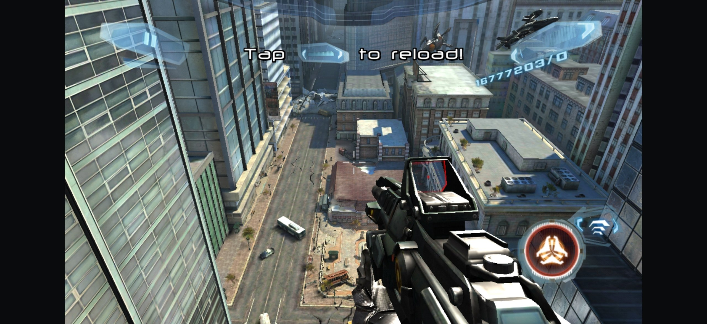
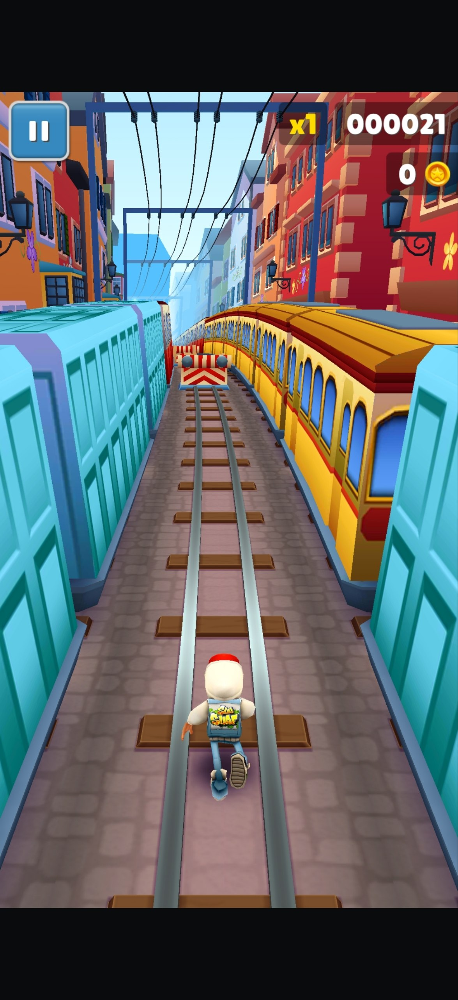
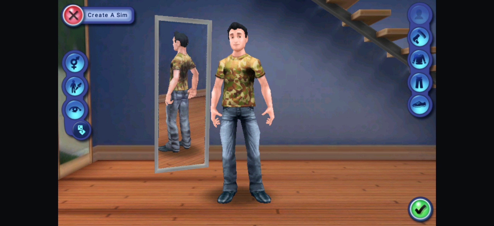

English · [中文](README.zh.md) · [Website](https://armbat.netlify.app/) · [Discord](https://discord.gg/dSpQ7XamWT)

[](https://github.com/dima-xd/armbat/releases/latest)
[](https://github.com/dima-xd/armbat/releases)
[](LICENSE)
[](#requirements)
[](https://github.com/dima-xd/armbat/stargazers)

# Armbat

Armbat runs 32-bit ARMv7 Android games on phones that no longer support them.
Import an APK, tap it, play. No root, no repackaging, no second Android inside.

Plenty of phones sold in the last few years have dropped the 32-bit ABI
completely: an `armeabi-v7a` APK refuses to install, and Play says the game is not
compatible with your device. Armbat gives those archives somewhere to run. A game
that goes through it stays a file in a folder you can open from any file manager;
nothing is patched and nothing is installed.

## Download

| Build | Where |
|---|---|
| Stable | [releases/latest](https://github.com/dima-xd/armbat/releases/latest) |
| Nightly | [releases/tag/nightly](https://github.com/dima-xd/armbat/releases/tag/nightly) |
| Every build and changelog | [armbat-web.vercel.app](https://armbat-web.vercel.app/builds) |

The app can also switch between the two channels in its settings.

## What it does

- Runs unmodified `armeabi-v7a` archives. 64-bit packages are not translated.
- A game keeps its own resolution, and rotation works.
- Touch reaches the guest as the platform delivered it: pointer ids, action index,
  pressure and timing are preserved, so multitouch in a game behaves as it does on
  a device that still has 32-bit support.
- Motion sensors work.
- Audio goes through OpenSLES.
- Saves, settings and expansion files live in `/sdcard/armbat/`, so a save can be
  copied in before the first launch and backed up later.
- A game that ships a protection SDK and refuses its own environment can be told
  to skip it, per app ([guides/silence.md](guides/silence.md)).

## Screenshots

All of these run on a phone with no 32-bit ABI at all.

| N.O.V.A. 3 | Subway Surfers | The Sims 3 |
|:---:|:---:|:---:|
|  |  |  |

## Compatibility

Games are checked one at a time on real hardware, and the reports are collected on
the site: [armbat-web.vercel.app/compatibility](https://armbat-web.vercel.app/compatibility).
If something runs for you and is missing from that list, add a report with the
[game compatibility template](https://github.com/dima-xd/armbat/issues/new?template=game_compatibility.yml).
A log from a game that fails is just as useful as one from a game that works.

## Requirements

- Android 12 (API 31) or newer on `arm64-v8a`. The device may have no 32-bit ABI
  at all; that is the case the container exists for.
- A GPU whose driver exposes EGL and GLES 2.0 or newer; rendering is forwarded to
  the host driver.
- "All files access" granted to the app: the library, a game's data and its
  expansion files live under shared storage.
- Only 32-bit ARMv7 (`armeabi-v7a`) archives are supported. For now.

## Install

1. Download the APK from [releases](https://github.com/dima-xd/armbat/releases/latest)
   and install it, allowing installs from this source.
2. Grant "All files access" when the app asks. Without the grant the library stays
   empty.
3. Put a game APK into `/sdcard/armbat/`, or use Import in the app.
4. Tap the game in the library.

An archive can be deleted from the same card it was imported from. Deleting it
removes the APK from `/sdcard/armbat/`, not the save data.

## Where files live

The container keeps everything under one folder on shared storage: `armbat` in
the root of the user storage, `/sdcard/armbat` on most devices. A private app
directory would not do, because imported APKs, saves and expansion files have to
be reachable from a file manager. The same folder is what the guest sees as its
own `/sdcard`.

```
/sdcard/armbat/
  logs/                            runtime and guest log files
  <package>-<version>.apk          imported archives
  silence/<package>                entries for Bypass checks
  android/data/<package>/
    files/                         Context.getFilesDir()
    cache/                         Context.getCacheDir()
    databases/                     SQLite databases
    shared_prefs/                  SharedPreferences
    external/files/                Context.getExternalFilesDir()
    external/cache/                Context.getExternalCacheDir()
  android/obb/<package>/           expansion files, main.*.obb and patch.*.obb
```

An imported archive is stored as `<packageName>-<versionName>.apk`, for example
`com.example.game-1.2.3.apk`. Importing another version of the same package
deletes the previous file, so the library keeps one copy per package. An APK
copied into the folder by hand is picked up as well.

Data can be put in place before the first launch: these directories are created
when the archive is imported, and again whenever the guest asks for one. An obb
only has to be copied into `android/obb/<package>/`, a save into `files/` or
`external/files/`.

Without "all files access" the folder cannot be read and the library stays empty
until the grant is given.

## Permissions

An imported archive is never installed, so its manifest does not belong to any
installed package. The guest runs under the container's package name and asks the
platform about itself, and the answer comes from the container's own manifest.
That is why the manifest declares the union of what ARMv7-era archives ask for:
network, phone state, location, camera, microphone, Wi-Fi, Bluetooth, storage and
the rest. A permission the container does not declare cannot be granted to a
guest at all.

Nothing is asked at startup. Before a guest leaves the launcher, the container
intersects the archive's permissions with its own, drops the ones it already
holds, and requests the dangerous remainder in one dialog. The guest cannot ask
for itself: a permission dialog belongs to a real activity and a real
`ActivityThread`, so a guest waiting for one would wait forever. Afterwards the
guest's own `checkPermission` calls see the platform's answer.

Only the intersection goes into the request. The framework refuses a batch that
contains a name the package does not declare, and refuses the whole batch with
it, so a camera permission the container never declared would silently deny the
phone-state request next to it. Names outside the intersection are logged once
and stay denied, exactly as for a package that never declared them.

Storage is the exception. `READ`/`WRITE_EXTERNAL_STORAGE` are capped by target SDK
on current releases and are answered "denied" to every application, which stops
an old archive at its own permission screen. The container needs all files access
anyway, because the library, a game's data and its expansion files live on shared
storage, so the guest is answered from that grant and the two legacy names are
not requested at all.

## How it works

Guest Java code runs on the platform's ART. Guest machine code is translated from
A32 to ARM64 by a JIT built on Dynarmic. There is no emulated Android and no
virtual disk: the game talks to the real framework, the real GPU driver and the
real filesystem.

- **One flat 4 GiB arena.** A guest address is a 32-bit offset into it, so
  fastmem works without translating pointers.
- **Real bionic userland.** The guest is not run against a re-implementation of
  libc: `runtime/sysroot` carries the linker, libc, libm, libdl and libstdc++
  from an official `armeabi-v7a` system image, and the container boots them.
- **Syscalls** go through `SVC #0`, Linux ARM EABI, dispatch by `r7`.
- **HLE only where the platform cannot be reused:** JNI, `AAssetManager`, EGL and
  GLES (forwarded to the host driver), `liblog`, `ANativeWindow`, OpenSLES.
  Guest libraries importing them get trampolines that trap into the container by
  symbol name.
- **Input** is a `MotionEvent` pass-through: the decor view is scaled to the
  guest surface, and the framework translates window to guest pixels per pointer,
  keeping id, action index, pressure and time.
- **ELF32 loader** handles segments, `DT_NEEDED`, `dlopen`/`dlsym`, ARM
  relocations (`R_ARM_RELATIVE`, `ABS32`, `GLOB_DAT`, `JUMP_SLOT`, `PREL31`) and
  `DT_INIT_ARRAY`.

A guest that dies leaves a fault report with module-relative offsets, so a crash
can be read without a second run: see [docs/debugging.md](docs/debugging.md).

## Bypass checks

An archive that ships a protection SDK can be told to leave it alone, per app.
The switch is the last row of the app card (long-press the icon); the file
format, the shipped defaults and the limits are described in
[guides/silence.md](guides/silence.md).

## Known limitations

- Only `armeabi-v7a` archives run. `arm64-v8a` games do not need Armbat and are
  not translated.
- There are no Google services. A game that needs a Play account, a license check
  or an online login will not get far; offline archives are the ones that work.
- Some launchers and engines still fail. Each one is investigated from a log
  rather than worked around per package.

## Build requirements

JDK 21, Android SDK with NDK 29.0.13113456 and CMake 3.31.6, Python 3.8+. NDK and
build-tools versions are pinned in `app/build.gradle.kts`; Gradle finds them
through the SDK.

## Build

Submodules are required: Dynarmic (a fork), Boost and the guest bionic sysroot.

```bash
git clone https://github.com/dima-xd/armbat.git
cd armbat
git submodule update --init

./gradlew :app:assembleRelease
```

The APK is written to `app/build/outputs/apk/release/app-release.apk`. Set
`versionCode`/`versionName` in `app/build.gradle.kts`; the runtime reports the
same number in its first log line, there is no second copy in C++.

### CLI build

The self-test suites are cross-compiled and meant to run on the device:

```bash
export ANDROID_NDK_ROOT=<sdk>/ndk/29.0.13113456
export ARMBAT_NINJA=<sdk>/cmake/3.31.6/bin/ninja
cmake --preset arm64
cmake --build --preset arm64
```

The binaries land in `build/arm64/tests/`. The suites and their fixtures (guest
libraries, test APKs, libc++) are not part of the APK build. To get the in-app
`Native.runSelfTest` entry point, configure with `-DARMBAT_SELFTEST_IN_APK=ON`.

## Repository layout

```
app/                  Kotlin/Compose UI and the launcher that owns the window,
                      EGL surface, input and orientation
platform/             android.app.NativeActivity compiled and dexed for the guest
runtime/
  include/armbat/     public headers: arena, A32Machine, loader, reports
  src/bionic/         start-up stack and the kuser helper page
  src/cpu/            arena and the Dynarmic wrapper
  src/heap/           guest malloc/free/calloc/realloc
  src/hle/            host implementations of platform imports
  src/kernel/         Linux ARM syscalls and guest memory
  src/loader/         ELF32: segments, dynamic section, relocations, dlopen
  src/jni/            JNI bridge and the Java-facing entry points
  src/runtime/        container, threads, watchdog, crash handler
  src/selftest/       JIT and loader suites
  sysroot/            bionic-sysroot submodule: guest linker, libc, libm, ...
tests/guest/          ARMv7 test program, native test libraries, baseline
tools/                generators, log analysis, APK packaging
third_party/          dynarmic and boost submodules
```

## Dynarmic fork

The JIT fixes (FPSR at run boundaries, whole-register `VLD1`/`VST1`, `VADDHN`,
and others) live as commits in `https://github.com/dima-xd/dynarmic`, pulled in as
the `third_party/dynarmic` submodule.

## Guest sysroot provenance

`runtime/sysroot` is not built by Armbat. It is a submodule pinned to a commit of
`dima-xd/bionic-sysroot`, which holds `linker`, `libc`, `libm`, `libdl`, `libc++`,
`libstdc++` and `libz` copied byte for byte out of the official Android 7.0
`armeabi-v7a` system image `system-images;android-24;default;armeabi-v7a`
(package `armeabi-v7a-24_r07.zip`, SHA-1
`3454546b4eed2d6c3dd06d47757d6da9f4176033`). The reproduction script lives at
`runtime/sysroot/tools/fetch-sysroot.ps1`; it verifies that archive and extracts
the files with `debugfs`. `runtime/sysroot/CHECKSUMS.txt` pins every extracted
file. All of it is AOSP bionic under Apache-2.0; see `NOTICE`.

Building these libraries from AOSP sources for `armeabi-v7a` API 24 is the
planned next step. Until then the pinned official image is the source of truth,
and no binary in this repository comes from anywhere else.

## Community

- Website: [armbat-web.vercel.app](https://armbat.netlify.app/)
- Discord: [discord.gg/dSpQ7XamWT](https://discord.gg/dSpQ7XamWT)
- Bugs and game reports: [issues](https://github.com/dima-xd/armbat/issues)

When a game fails, attach the log from `/sdcard/armbat/logs/`. It already contains
module-relative offsets, so it can be read without the exact APK.

## License

Armbat is licensed under the Apache License, Version 2.0; see `LICENSE`.

Bundled components keep their own terms: Dynarmic is 0BSD, Boost comes from
`Vita3K/ext-boost` (BSL-1.0), and `runtime/sysroot` is AOSP bionic (Apache-2.0),
copied byte for byte from the Android 7.0 `armeabi-v7a` system image. All
submodules are pinned to commits; `NOTICE` lists them.
