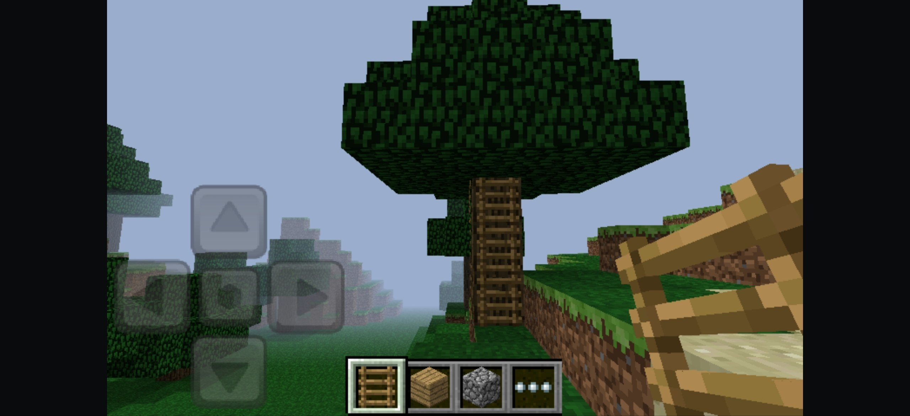

[English](README.md) · [中文](README.zh.md)

[](https://discord.gg/dSpQ7XamWT)

# Armbat

Armbat 是一个容器，用于在没有 32 位 ABI 的 64 位设备上运行 32 位 ARM Android
应用。访客 Java 代码由平台自带的 ART 执行；访客机器码由基于 Dynarmic 的 JIT 从 A32
翻译为 ARM64。无需 root。

表面上看，它只是一个小型应用库：导入 APK、启动、删除。真正的工作在底层：一个 C++20
运行时，自带 ELF 加载器、系统调用层和平台桩。

## 工作原理

- **一块扁平的 4 GiB 地址空间。** 访客地址就是其中的 32 位偏移，因此 fastmem 无需转换
  指针即可工作。
- **真正的 bionic 用户态。** 访客不是跑在 libc 的重实现上：`runtime/sysroot` 带有官方
  `armeabi-v7a` 系统镜像中的 linker、libc、libm、libdl 和 libstdc++，由容器负责启动
  它们。
- **系统调用** 走 `SVC #0`，Linux ARM EABI，按 `r7` 分发。
- **只在平台无法复用时使用 HLE：** JNI、`AAssetManager`、EGL 与 GLES（转发给宿主
  驱动）、`liblog`、`ANativeWindow`、OpenSLES。导入这些符号的访客库会得到跳板，按
  符号名陷入容器。
- **输入** 是 `MotionEvent` 直通：decor 视图缩放到访客表面，框架逐指将窗口坐标换算为
  访客像素，保留 id、action index、压力和时间。
- **ELF32 加载器** 处理段、`DT_NEEDED`、`dlopen`/`dlsym`、ARM 重定位
  （`R_ARM_RELATIVE`、`ABS32`、`GLOB_DAT`、`JUMP_SLOT`、`PREL31`）和
  `DT_INIT_ARRAY`。

唯一真正的验收测试是 Minecraft 1.2.0.81（`com.mojang.minecraftpe`）：菜单、创建并加载
世界、渲染、可玩的帧率、多点触控。`tests/` 下的合成测试只是开发辅助，不是证明。

## 截图

|                     N.O.V.A. 3                     |                      The Sims 3                      |
|:--------------------------------------------------:|:----------------------------------------------------:|
|                |                  |

|                     Subway Surfers                     |                     Minecraft                      |
|:------------------------------------------------------:|:--------------------------------------------------:|
|               |             |

## 设备要求

- Android 12（API 31）或更高，`arm64-v8a`。设备完全可以没有任何 32 位 ABI；这正是
  容器存在的场景。
- GPU 驱动需支持 EGL 和 GLES 2.0 或更高；渲染会转发给宿主驱动。
- 需要授予应用“所有文件访问权限”：应用库、游戏数据及其扩展文件都位于共享存储中。
- 目前只支持 32 位 ARMv7（`armeabi-v7a`）归档。

## 权限

导入的归档从不安装，因此它的清单不属于任何已安装的包。访客以容器的包名运行，向平台
询问自身信息时，答案来自容器自己的清单。这就是为什么清单声明了 ARMv7 时代归档常用权限
的并集：网络、电话状态、位置、相机、麦克风、Wi-Fi、蓝牙、存储等等。容器没有声明的
权限，根本无法授予访客。

启动时不会请求任何权限。在访客离开启动器之前，容器会把归档的权限与自己的权限求交集，
去掉自己已持有的，再通过一个对话框请求剩余的危险权限。访客无法自己请求：权限对话框
属于真实的 activity 和真实的 `ActivityThread`，访客若等待它就会永远等下去。之后，
访客自己的 `checkPermission` 调用会看到平台给出的答案。

只有交集会进入请求。框架会拒绝包含包未声明名称的批次，并且连同整批一起拒绝，因此容器
从未声明的相机权限会悄悄连累旁边的电话状态请求。交集之外的名称会记录一次日志并保持
拒绝，与从未声明它们的包完全相同。

存储是例外。在当前版本上，`READ`/`WRITE_EXTERNAL_STORAGE` 受 target SDK 限制，对每个
应用都回答“拒绝”，这会让旧归档卡在它自己的权限界面上。容器无论如何都需要所有文件访问
权限，因为应用库、游戏数据及扩展文件都在共享存储上，所以访客会从该授权得到答案，而这两
个旧权限名根本不会被请求。

## 文件位置

容器把所有内容放在共享存储的一个文件夹下：用户存储根目录中的 `armbat`，在大多数设备上
是 `/sdcard/armbat`。私有应用目录不行，因为导入的 APK、存档和扩展文件必须能从文件管理
器访问。访客看到的自己的 `/sdcard` 就是同一个文件夹。

```
/sdcard/armbat/
  logs/                            运行时和访客日志文件
  <package>-<version>.apk          导入的归档
  android/data/<package>/
    files/                         Context.getFilesDir()
    cache/                         Context.getCacheDir()
    databases/                     SQLite 数据库
    shared_prefs/                  SharedPreferences
    external/files/                Context.getExternalFilesDir()
    external/cache/                Context.getExternalCacheDir()
  android/obb/<package>/           扩展文件，main.*.obb 和 patch.*.obb
```

导入的归档保存为 `<packageName>-<versionName>.apk`，例如
`com.mojang.minecraftpe-1.2.0.81.apk`。导入同一包名的另一个版本会删除之前的文件，因此
应用库每个包只保留一份。手动复制到该文件夹的 APK 也会被识别。

可以在首次启动前把数据放好：这些目录会在导入归档时创建，并在访客每次请求时再次创建。
obb 只需复制到 `android/obb/<package>/`，存档复制到 `files/` 或 `external/files/`。

没有“所有文件访问权限”，就无法读取该文件夹，应用库会一直为空，直到获得授权。

## 构建要求

JDK 21、带 NDK 29.0.13113456 和 CMake 3.31.6 的 Android SDK、Python 3.8+。NDK 与
build-tools 版本固定在 `app/build.gradle.kts`；Gradle 通过 SDK 找到它们。

## 构建

需要子模块：Dynarmic（分支）、Boost 和访客 bionic sysroot。

```bash
git clone https://github.com/dima-xd/armbat.git
cd armbat
git submodule update --init

./gradlew :app:assembleRelease
```

APK 输出到 `app/build/outputs/apk/release/app-release.apk`。在
`app/build.gradle.kts` 中设置 `versionCode`/`versionName`；运行时会在第一行日志中报告
相同编号，C++ 中没有第二份副本。

### CLI 构建

自测套件会交叉编译，并设计为在设备上运行：

```bash
export ANDROID_NDK_ROOT=<sdk>/ndk/29.0.13113456
export ARMBAT_NINJA=<sdk>/cmake/3.31.6/bin/ninja
cmake --preset arm64
cmake --build --preset arm64
```

生成的二进制位于 `build/arm64/tests/`。这些套件及其夹具（访客库、测试 APK、libc++）
不属于 APK 构建。要获得应用内的 `Native.runSelfTest` 入口，请使用
`-DARMBAT_SELFTEST_IN_APK=ON` 配置。


## 仓库结构

```
app/                  Kotlin/Compose UI，以及掌管窗口、EGL 表面、输入和
                      屏幕方向的启动器
platform/             为访客编译并 dex 化的 android.app.NativeActivity
runtime/
  include/armbat/     公共头文件：arena、A32Machine、loader、reports
  src/bionic/         启动栈和 kuser helper 页
  src/cpu/            arena 和 Dynarmic 封装
  src/heap/           访客 malloc/free/calloc/realloc
  src/hle/            平台导入的宿主实现
  src/kernel/         Linux ARM 系统调用和访客内存
  src/loader/         ELF32：段、动态段、重定位、dlopen
  src/jni/            JNI 桥和面向 Java 的入口
  src/runtime/        容器、线程、看门狗、崩溃处理
  src/selftest/       JIT 和加载器套件
  sysroot/            bionic-sysroot 子模块：访客 linker、libc、libm、...
tests/guest/          ARMv7 测试程序、原生测试库、基线
tools/                生成器、日志分析、APK 打包
third_party/          dynarmic 和 boost 子模块
```

## Dynarmic 分支

JIT 修复（运行边界处的 FPSR、整寄存器 `VLD1`/`VST1`、`VADDHN` 等）以提交形式位于
`https://github.com/dima-xd/dynarmic`，并作为 `third_party/dynarmic` 子模块引入。

## 访客 sysroot 来源

`runtime/sysroot` 不是由 Armbat 构建的。它是一个固定在 `dima-xd/bionic-sysroot` 某个
提交上的子模块，其中保存着从官方 Android 7.0 `armeabi-v7a` 系统镜像
`system-images;android-24;default;armeabi-v7a`（包 `armeabi-v7a-24_r07.zip`，SHA-1
`3454546b4eed2d6c3dd06d47757d6da9f4176033`）逐字节复制出来的 `linker`、`libc`、
`libm`、`libdl`、`libc++`、`libstdc++` 和 `libz`。复现脚本位于
`runtime/sysroot/tools/fetch-sysroot.ps1`；它会校验该归档，并用 `debugfs` 提取文件。
`runtime/sysroot/CHECKSUMS.txt` 固定了每个提取出的文件。所有内容都是 Apache-2.0 下的
AOSP bionic；参见 `NOTICE`。

从 AOSP 源码为 `armeabi-v7a` API 24 构建这些库是计划中的下一步。在此之前，固定的官方
镜像是唯一事实来源，本仓库中没有任何二进制来自别处。

## 许可证

Armbat 按 Apache License 2.0 授权；见 `LICENSE`。

捆绑组件保留各自条款：Dynarmic 为 0BSD，Boost 来自 `Vita3K/ext-boost`
（BSL-1.0），`runtime/sysroot` 为 AOSP bionic（Apache-2.0），逐字节复制自 Android 7.0
`armeabi-v7a` 系统镜像。所有子模块都固定在具体提交上；`NOTICE` 列出了它们。
